> [!IMPORTANT]
> Remove this line to confirm you've reviewed this PR before submitting.

# zedTracer

zedTracer is a fork of [Zed](https://github.com/zed-industries/zed) for working with Kusto (Azure Data Explorer):
writing KQL, reading what a query returned, and following a distributed trace from a log line back to the code that
wrote it. Everything upstream Zed does still works. The fork adds a Kusto language extension and a results workbench,
plus a few small changes to the editor and GPUI that those features need.

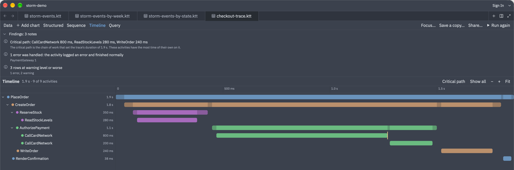

> The screenshots use mock data, so you can open the same files without a cluster or a sign-in. The StormEvents
> results have the shape of the `StormEvents` table in the public `help.kusto.windows.net/Samples` database, but the
> values are invented. The checkout trace is made up too. The files and the script that writes them are in
> [`fork-docs/readme-demo`](fork-docs/readme-demo).

## Contents

- [Writing Kusto queries](#writing-kusto-queries)
- [The results workbench](#the-results-workbench)
- [Charts](#charts)
- [Reading a trace](#reading-a-trace)
- [Sharing a query and its result](#sharing-a-query-and-its-result)
- [Query threads](#query-threads)
- [Other changes to Zed](#other-changes-to-zed)
- [Getting started](#getting-started)
- [Upstream Zed](#upstream-zed)

The full reference for everything below is [`extensions/kusto/README.md`](extensions/kusto/README.md). Design notes
and specifications are in [`fork-docs`](fork-docs).

## Writing Kusto queries

The Kusto extension ([`extensions/kusto`](extensions/kusto)) attaches a .NET language server built on
`Microsoft.Azure.Kusto.Language` to `.kql` files. A file holds any number of queries separated by blank lines, and
each query is analyzed and run on its own.

```kql
// :setDefaultCluster("https://help.kusto.windows.net")
// :setDefaultDb("Samples")

// Storm events a week, by type
StormEvents
| where EventType in ("Thunderstorm Wind", "Hail", "Flash Flood", "Tornado")
| summarize Events = count() by bin(StartTime, 7d), EventType
| render timechart
```

- **Schema from your clusters.** The server signs in with `az account get-access-token` and loads the tables,
  columns, functions, materialized views and entity groups of each database a query uses, including databases named
  with `cluster(...)` and `database(...)`. Schemas are cached on disk, so completion works offline as soon as the
  server starts. Completion, hover, signature help and `macro-expand` over entity groups all use the schema.
- **Semantic colours.** Tokens come from Kusto's own analysis, so tables, columns, functions, `let` variables and
  parameters each get their own colour. The extension has no Tree-sitter grammar.
- **Diagnostics.** Syntax errors are always reported. Once a query's schema has loaded, unknown tables, columns and
  functions are reported as errors too. When the source table itself is unknown, only that error is shown, not the
  cascade of errors that follows from it.
- **Directives.** Comment lines set where the queries below them run (`// :setDefaultCluster`,
  `// :setDefaultDb`), give values to parameters (`// :setParam("raid", "abc-123")`), and define functions for the
  queries below (`// :functions`). Queries with no directive use `kusto.cluster` and `kusto.database` from your
  settings.
- **Query parameters.** A query that runs `declare query_parameters(...)` takes its values from the active profile
  in `.kusto/parameters.yaml`. The values are sent as native query parameters, never pasted into the query text.
  A lens shows the active profile and switches it, and each profile in the YAML file gets a **Make Active** lens.
- **Code lenses** above each query: **▶ Run** (or F5 / Shift-Enter), a live **Running… 12 s** with **Cancel**,
  **Results (1,240 rows)**, **Params**, the last run's time, **Copy**, **Share**, the connection, the schema's age
  (click it to refresh), **Snapshot functions** and **Copy CID**. Turn lenses on with `"code_lens": "on"`.
- **Copy** writes the query so it runs anywhere: names are qualified with their cluster and database, parameters
  become `let` statements, and the functions the query uses from `// :functions` blocks are included.
- **Control commands** such as `.show functions` run like any other query.
- **Navigation.** The outline (Cmd-Shift-O) lists the queries in a file. Cmd-T finds queries and function definitions
  across the project. Go to Definition on a stored function opens its `.create-or-alter function` file, which
  **Snapshot functions** writes for every function in the database so that `git diff` shows what changed on the
  cluster.
- **Snippets.** **Save Query as Snippet** (in the right-click menu) adds the query under the cursor to your Kusto
  snippets.
- **History.** Every run is saved. **kusto: show history** lists past runs. You can search them, reopen a result,
  rerun a query with the parameter values it had, or delete old results.

## The results workbench

A run's result opens in the Results panel, or in a tab when `kusto.results_location` is `"editor"`. Any `.ktt` or
`.kqr` file also opens as a result: these are the result files of the VS Code KustoTraceTools extension, and every run
writes one.

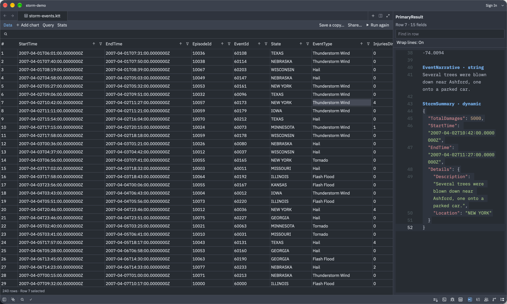

- **The grid** handles hundreds of thousands of rows. It has typed sorting (nulls first, 64-bit and decimal values
  kept exactly, natural order for text), filter popovers with two conditions each, search, resizable and reorderable
  columns that are saved with the file, and keyboard selection, including rows that aren't next to each other.
  Rows are tinted by severity when the table has a `level` or `severity` column.
- **Copy** the selection as text, Markdown, HTML, or a KQL `datatable`, or use **Export as CSV…** to save it as an
  RFC 4180 CSV file.
- **Row Details** docks beside the result and shows every field of the selected row. Dynamic values are shown as
  formatted JSON, and it has its own find (Cmd-F).
- **Results with several tables** get a **Data 2**, **Data 3** … tab for each table after the first.
- **Query** shows the query the result came from, with where and when it ran and its parameter values.
  **Run again** reruns it and refreshes the file in place, keeping the result's charts and column layout.
  **Save a copy…** keeps a history result under a readable name.
- **Stats** shows what the run cost the service, as the Azure Data Explorer web UI does: time, CPU, memory, disk
  cache, network, result size, and extents and rows scanned. Queries that reach other clusters get a breakdown for
  each cluster.

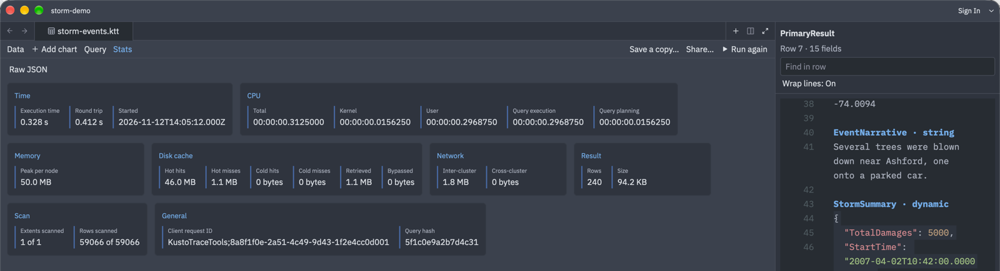

## Charts

A query that ends in `render` gets its chart saved with the result. You can also add a chart to any result with
**Add chart**. Supported types are line, time line, bar, column, and the stacked and 100% stacked forms of bars and
columns. Hover a line chart for a crosshair tooltip that lists every series at that point. Click a legend entry to
hide or show its series.

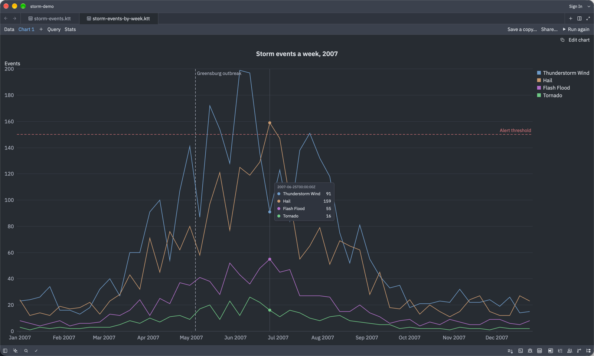

**Edit chart** opens a pane for the chart type, columns, series, sort, running totals, how rows at the same X are
combined, titles, axis scales and limits, gridlines, legend, and text size. A change redraws the chart at once and is
saved to the result file. Right-click a chart to add a horizontal or vertical line at the pointer, such as a
threshold or the moment of a release. **Copy chart** puts a PNG of the chart on the clipboard.

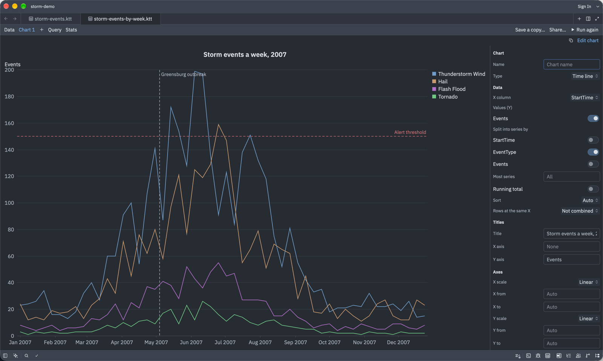

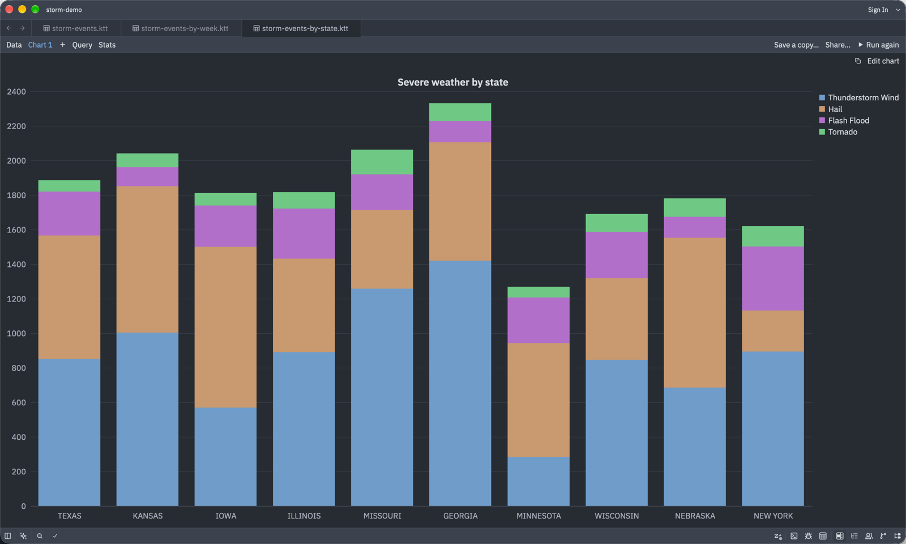

## Reading a trace

When a result has the columns of a trace (activity id, parent activity id, timestamp, message, and optionally marker,
process, severity and root activity id), zedTracer builds more views from it. You can map your own column names with
`kusto_results.trace_columns`.

The grid tints rows by severity and dims the structural rows that only say a scope started or ended. **Hide
structural rows** removes those rows. The **findings strip** sums up the trace: where a failure started, the
critical path, untraced time, repeated work, errors that were handled, the mix of severities, and problems with the
data itself. Each finding links to its rows.

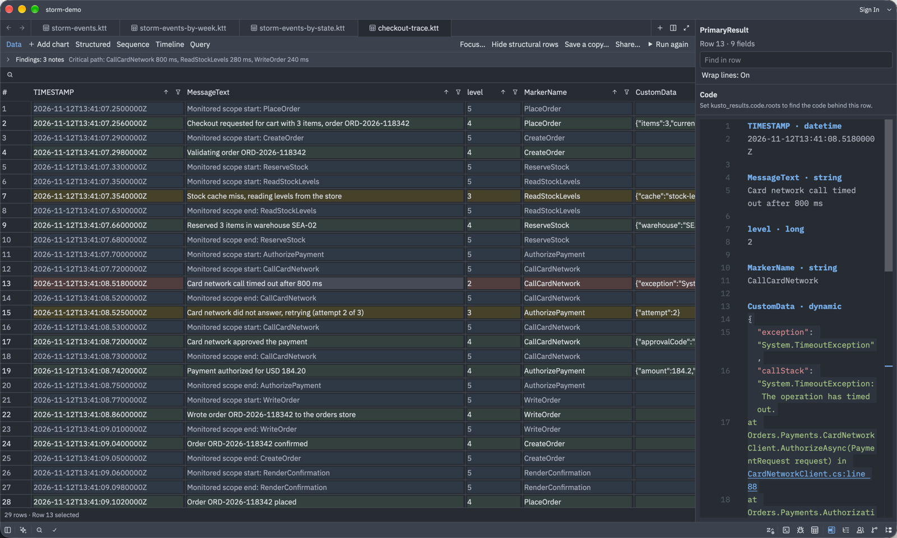

**Structured** shows the activity tree with each activity's duration and start offset, next to the events of the
selected activity. The `↳` and `↲` rows mark where each child activity starts and ends, so you can see which children
ran side by side. Orphaned activities are placed under the root that carries their parent's id.

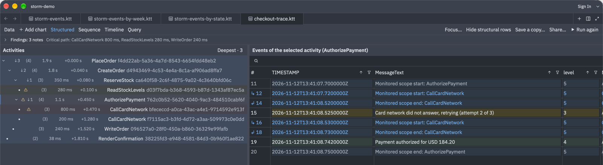

**Sequence** draws the calls between processes as a Mermaid sequence diagram. Each actor keeps the same colour it
has in the timeline. The diagram can group repeated calls into steps and collapse loops, and you can zoom it with a
pinch or Cmd-scroll.

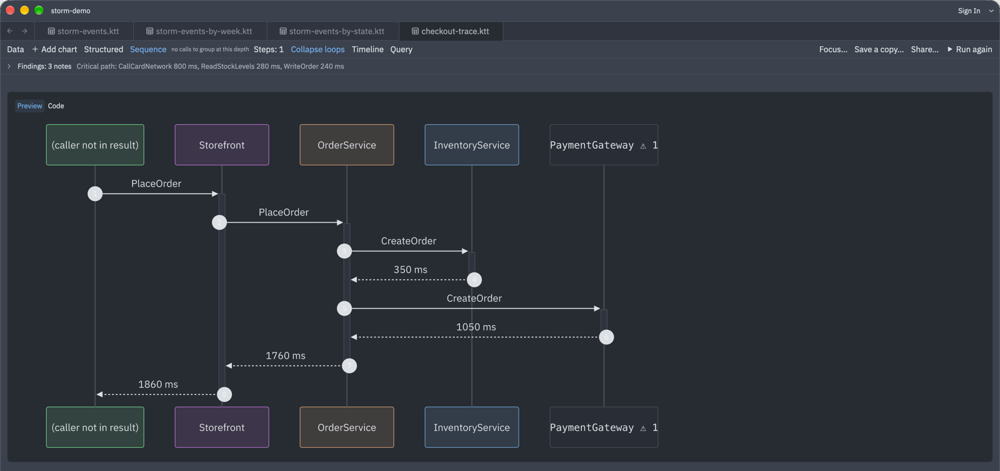

**Timeline** is a waterfall of where the time went. It folds short activities together, can highlight the critical
path, and has a splitter between the labels and the bars. Hatched stretches are untraced time, where the activity
logged nothing, and a mark on a bar shows where an error was logged or handled. **Focus…** (or right-clicking a row, node or bar) rebuilds every view around a single activity
and everything below it.

**The code behind a row.** Set `kusto_results.code.roots` to the folders that hold your git checkouts, and Row
Details lists the code the selected row points to: the method that uses its marker, the line that logged its message
(found by the message's text), the methods its message names, and the frames of its call stacks. Call stack frames
such as `CardNetworkClient.cs:line 88` are links. Clicking one opens the file at that line in a pane beside the
trace, inside its checkout's worktree, so a C# language server can go to definitions across the repository.

## Sharing a query and its result

**Share** (a lens above each query, or the **Share…** button on a result) copies three things for someone else:

- a link that opens the query in the Azure Data Explorer web UI,
- the query, written as **Copy** writes it,
- the rows, as a Markdown table or as rich text (an HTML table that pastes into mail and chat), either all of them
  or the top N.

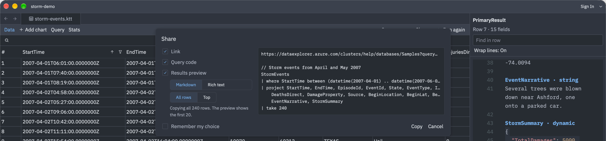

## Query threads

A query thread keeps the queries of one investigation together without creating a file. Threads appear in the
Threads sidebar next to agent threads, and the agent panel shows the thread's Kusto editor. Start one with
`agent: new query thread`, or choose **Kusto query** in the agent panel's new thread menu. Each run in a thread opens
its result in a tab.

## Other changes to Zed

- **Window gradient.** Themes and `theme_overrides` can set `background.gradient` (an angle and two colours), which
  is painted behind the whole window. Surfaces with a translucent background let it show through.

  ```json
  "theme_overrides": {
    "One Dark": {
      "background.gradient": { "angle": 135, "from": "#1d3557ff", "to": "#5a2a59ff" },
      "background": "#00000000",
      "editor.background": "#1b1f2a80",
      "panel.background": "#1b1f2a80"
    }
  }
  ```

  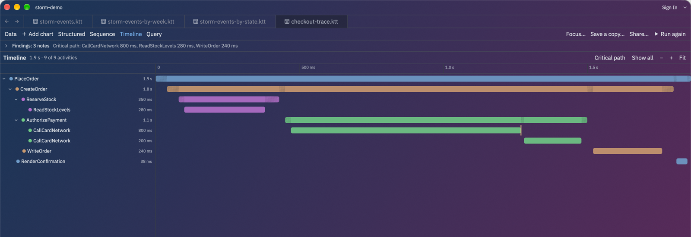

- **Editor.** A code lens can run a Zed action (`zed.dispatchAction`) and can sit on a line below the first. The
  editor context menu can offer **Save Query as Snippet**.
- **Markdown.** Mermaid diagrams can be zoomed with a pinch, keep horizontal scrolling, and let a document choose
  their accent colours.
- **GPUI.** The clipboard can hold text and HTML together (on macOS).
- **Workspace.** Pinned tabs stay pinned when moved between panes, and the status bar's panel buttons are larger.
- **Agent.** Tool call locations that are directories, or that don't exist, are skipped.
- **Branding.** The development build is named zedTracer and has its own icons. `script/bundle-mac` signs local
  bundles with your Apple Development identity, so macOS permissions survive a rebuild.

## Getting started

1. Build and install the app. On macOS:

   ```sh
   script/bundle-mac -i      # builds a release bundle and installs it into /Applications
   ```

   Building from source works as it does for upstream Zed. See [Building Zed for macOS](./docs/src/development/macos.md).

2. Build the Kusto language server (needs the .NET 8 SDK), then install the extension with
   **zed: install dev extension** and choose [`extensions/kusto`](extensions/kusto):

   ```sh
   extensions/kusto/install-server.sh
   ```

3. Sign in for schema and running queries with `az login`, then set a default cluster and turn on code lenses:

   ```json
   {
     "code_lens": "on",
     "kusto": { "cluster": "https://help.kusto.windows.net", "database": "Samples" }
   }
   ```

4. Open a `.kql` file and press F5 on a query. To try the results workbench without a cluster, open any `.ktt` file
   in [`fork-docs/readme-demo`](fork-docs/readme-demo) or [`fork-docs/samples`](fork-docs/samples).

---

## Upstream Zed

[](https://zed.dev)
[](https://github.com/zed-industries/zed/actions/workflows/run_tests.yml)

Welcome to Zed, a high-performance, multiplayer code editor from the creators of [Atom](https://github.com/atom/atom) and [Tree-sitter](https://github.com/tree-sitter/tree-sitter).

### Installation

On macOS, Linux, and Windows you can [download Zed directly](https://zed.dev/download) or install Zed via your local package manager ([macOS](https://zed.dev/docs/installation#macos)/[Linux](https://zed.dev/docs/linux#installing-via-a-package-manager)/[Windows](https://zed.dev/docs/windows#package-managers)).

Other platforms are not yet available:

- Web ([tracking discussion](https://github.com/zed-industries/zed/discussions/26195))

### Developing Zed

- [Building Zed for macOS](./docs/src/development/macos.md)
- [Building Zed for Linux](./docs/src/development/linux.md)
- [Building Zed for Windows](./docs/src/development/windows.md)

### Contributing

See [CONTRIBUTING.md](./CONTRIBUTING.md) for ways you can contribute to Zed.

Also... we're hiring! Check out our [jobs](https://zed.dev/jobs) page for open roles.

### Licensing

Zed source code is licensed primarily under GPL-3.0-or-later, with Apache-2.0 components where marked.

License information for third party dependencies must be correctly provided for CI to pass.

We use [`cargo-about`](https://github.com/EmbarkStudios/cargo-about) to automatically comply with open source licenses. If CI is failing, check the following:

- Is it showing a `no license specified` error for a crate you've created? If so, add `publish = false` under `[package]` in your crate's Cargo.toml.
- Is the error `failed to satisfy license requirements` for a dependency? If so, first determine what license the project has and whether this system is sufficient to comply with this license's requirements. If you're unsure, ask a lawyer. Once you've verified that this system is acceptable add the license's SPDX identifier to the `accepted` array in `script/licenses/zed-licenses.toml`.
- Is `cargo-about` unable to find the license for a dependency? If so, add a clarification field at the end of `script/licenses/zed-licenses.toml`, as specified in the [cargo-about book](https://embarkstudios.github.io/cargo-about/cli/generate/config.html#crate-configuration).

### Sponsorship

Zed is developed by **Zed Industries, Inc.**, a for-profit company.

If you’d like to financially support the project, you can do so via GitHub Sponsors.
Sponsorships go directly to Zed Industries and are used as general company revenue.
There are no perks or entitlements associated with sponsorship.
